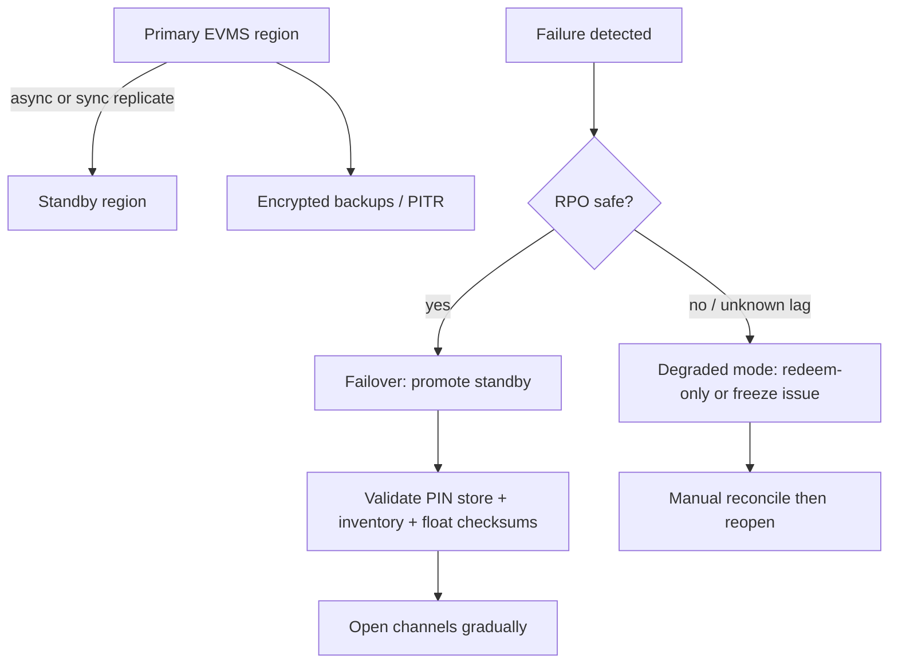

# Electronic Voucher Management Disaster Recovery

An educational guide to **disaster recovery (DR)** thinking for an **electronic voucher management system (EVMS / EVD)**: RPO and RTO targets for PIN stores, inventory ledgers, and float — and how operators keep voucher platforms recoverable without silent double-issue. Written for operators, fintechs, and product teams looking at platforms in the [EVD System](https://evdsystem.com/) and [MoboGage](https://evdsystem.com/about-mobogage/) family.

---

## What Is EVMS Disaster Recovery?

**Disaster recovery for electronic voucher management** is the set of architecture, backup, failover, and runbook practices that restore selling and redemption of vouchers after a site, region, or critical component failure — within agreed **RPO** (how much data you may lose) and **RTO** (how long you may be down).

EVD platforms are unforgiving: a restored inventory that is minutes behind a live sell path can re-issue PINs already sold, or lose float movements that finance already booked. DR is therefore not only "bring the database back" — it is **consistent recovery of PIN stores, inventory state, and float**.

### Typical use cases

- **Telecom EVD** surviving a primary DC outage without stopping dealer POS forever
- **Gift-card / voucher programs** failing over redemption while freezing issue if ledger lag is unsafe
- **Finance and risk** proving RPO/RTO for audits and partner SLAs
- **Ops** rehearsing restore drills before peak seasons

---

## How It Works

### Core components

| Component | Responsibility |
|-----------|----------------|
| **PIN / secret store** | Encrypted vault of unsold and sold credential material |
| **Inventory ledger** | Serial status, channel allocation, sell history |
| **Float / credit ledger** | Dealer and agent credit positions tied to EVD |
| **Replication & backups** | Cross-region replicas, point-in-time recovery |
| **Failover controller** | Health checks, promote, DNS/traffic shift |
| **Degraded-mode policy** | What stays up when consistency is uncertain |
| **Drill / runbooks** | Scheduled failover tests and communication trees |

See [docs/evms-dr-checklist.md](./docs/evms-dr-checklist.md) for an RPO/RTO and drill checklist.

---

## RPO / RTO Thinking for EVD

| Domain | Typical pressure | DR implication |
|--------|------------------|----------------|
| **PIN store** | Zero tolerance for re-issuing sold PINs | Prefer sync or near-sync; freeze issue if lag unknown |
| **Inventory status** | Double-sell risk under lag | Atomic status must recover consistently with PIN store |
| **Float / CreditSync** | Finance breakage if credits vanish or duplicate | Replicate with inventory or reconcile before reopen |
| **Read APIs (balance)** | Customer experience | May serve stale reads briefly if writes are frozen |
| **Reporting** | Can lag | Rebuild from ledger after promote |

There is no single "industry number" — publish targets that match your sell rate, partner SLAs, and regulator expectations, then test them.

---

## Design Considerations

- **Consistency over availability for issue.** Prefer pausing new voucher sales over risking double-issue during uncertain failover.
- **Redeem vs issue split.** Some programs allow redemption from a verified standby while issue stays frozen until checksums pass.
- **Encrypt backups and replicas.** PIN material is credential-grade; DR copies need the same control plane as production.
- **Checksum before open.** Compare serial counts, last sell IDs, and float totals between promote candidate and last known good.
- **Idempotent channel clients.** POS and API must survive failover retries without double-commit when the primary returns.
- **Run drills.** Untested RTO is fiction; rehearse with observers from ops, security, and finance.
- **Document degraded mode.** Staff need a one-page "what we turn off first" list, not a novel.

MoboGage's EVD System combines electronic voucher management, PIN security, and reconciliation controls — DR planning should treat those as one consistency boundary, not three unrelated databases.

---

## FAQ

**What is RPO for an EVMS?**
Recovery Point Objective: the maximum age of data you accept on restore. For PIN/inventory, many operators target seconds to low minutes — and freeze issue if lag exceeds the target.

**What is RTO?**
Recovery Time Objective: how long sell/redeem may stay unavailable (or degraded) after a declared disaster.

**Should issue and redeem fail over together?**
Not always. If inventory lag is unsafe, freeze issue and allow redeem-only from a verified copy until reconcile completes.

**How do backups differ from hot standby?**
Backups protect against corruption and ransomware; hot standby protects against site loss. You usually need both.

**How does this relate to MoboGage / EVD System?**
MoboGage provides EVMS/EVD capabilities including reconciliation and PIN security. See [electronic voucher management system for telecom](https://evdsystem.com/electronic-voucher-management-system-evd-telecom/) and [voucher reconciliation and PIN security](https://evdsystem.com/evd-software/voucher-reconciliation-pin-security-evms/).

**What is the biggest DR failure mode in EVD?**
Promoting a lagging inventory and selling PINs that were already sold on the primary — fix with lag gates, checksums, and issue freezes.

---

## Glossary (short)

- **RPO** — maximum acceptable data loss window on recovery
- **RTO** — maximum acceptable time to restore service
- **PIN store** — protected storage for voucher credentials
- **Degraded mode** — limited service (e.g. redeem-only) during uncertain consistency
- **Failover drill** — rehearsed promotion of standby with measured RTO

---

## Further Reading / Related Industry Resources

- [Electronic voucher management system (EVD) for telecom](https://evdsystem.com/electronic-voucher-management-system-evd-telecom/) — EVMS product context
- [Voucher reconciliation and PIN security (EVMS)](https://evdsystem.com/evd-software/voucher-reconciliation-pin-security-evms/) — integrity controls that DR must preserve
- Related repo: [electronic-voucher-system-high-availability](https://github.com/iwtglobal/electronic-voucher-system-high-availability) — HA patterns for voucher platforms

---

## License

Documentation in this repository is provided under the MIT License. See [LICENSE](./LICENSE).

*Educational material only. Not legal, regulatory, or financial advice. MoboGage and EVD System refer to offerings on evdsystem.com.*
